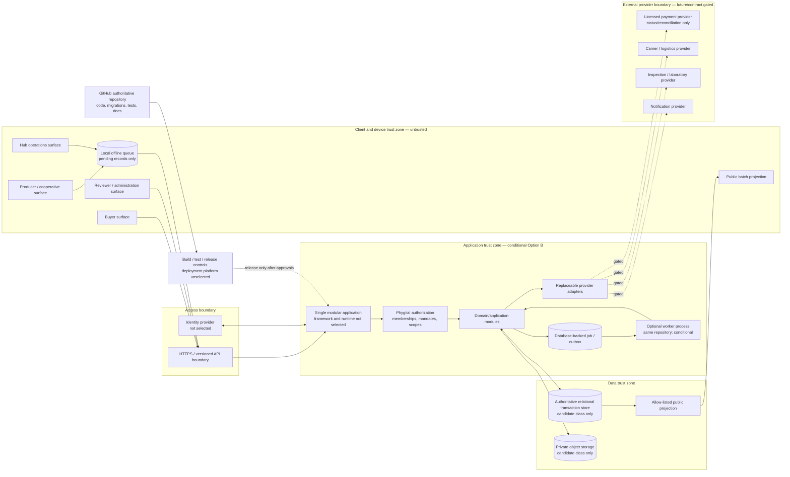

# Conditional pilot topology and trust boundaries

**Review date:** 21 November 2026  
**Linked evidence item:** EVI-27 — Record the authorised topology decision in ADR-0002  
**Design status:** CONDITIONAL REVIEW ARTEFACT — NOT APPROVED  
**Logical candidate illustrated:** Option B, modular monolith with replaceable service boundaries  
**Technology/provider status:** Unselected

## 1. Purpose and authority

This design translates current source-backed product, workflow, identity, data, security and operating requirements into a candidate-neutral logical topology for review. It is a review aid for EVI-27 and ADR-0002, not an architecture approval or implementation instruction.

The Concept Paper v1.1 remains the strategic authority. Technical Development Manual v3.0 remains the supporting technical plan. 018-A D-01–D-07 and 024-A–G constrain business, authority, workflow, data, API, interface, security and test boundaries. TSBBF v1.0 governs component selection; AADDG v1.0 governs repository/build/release and operational controls.

## 2. Conditional logical topology

The diagram depicts a single modular application as a candidate logical shape. The named stores and services are technology classes, not selected products or providers.

## 3. Trust-boundary rules

| Boundary | Required control |
|---|---|
| Client/device → API | Treat clients and local storage as untrusted. Validate every request server-side. Offline records remain visibly pending until accepted by the server. |
| Authentication → authorization | Authentication proves a session; it does not grant business authority. Phygital evaluates current membership, mandate, organisation scope, role and action permission. |
| Application → domain modules | UI and provider SDKs do not directly mutate privileged business state. Domain/application services enforce invariants and audit material actions. |
| Application → transaction store | One authoritative transaction source is the conditional baseline. Enforce atomic allocation, immutable accepted commercial snapshots, audit and state transitions. |
| Application → private files | Store file blobs privately. Keep ownership, classification, hash, evidence status and entity links in controlled metadata. Use scoped, short-lived access. |
| Data store → public projection | Publish only an explicit allow-list. Never expose raw database rows, private files, personal data or commercial terms through public batch pages. |
| Application → external providers | Use replaceable adapters, scoped credentials, authenticated callbacks, idempotency, replay protection and reconciliation. No uncontracted/live provider integration is implied. |
| Repository → release | One authoritative GitHub repository is the source of code and deployment configuration. Build, test, acceptance, release and rollback are governed; provider is not selected. |

## 4. Data-boundary rules

- **Credentials and sessions:** remain with the selected identity service; do not make it the source of Phygital business mandates.
- **Organisation membership and authority:** Phygital-owned records with scope, validity, revocation and audit.
- **Product, supply, batch, quality, inventory and order state:** authoritative transaction records with provenance and explicit lifecycle.
- **Documents and evidence files:** private blobs with controlled metadata, integrity hashes, classification, expiry and access history.
- **Public batch information:** a separately generated allow-listed projection; revocable and privacy-minimised.
- **Payment:** terms, references, reported/verified status and reconciliation exceptions only. No platform custody, escrow, funds receipt or payout is assumed.
- **Physical measurements:** distinguish declared, hub-recorded, device-measured and independently verified evidence. Retain instrument, operator, time, unit, calibration and correction provenance where applicable.
- **Audit and observability:** capture material actions while minimising secrets, credentials, personal data and unnecessary payloads in logs.

## 5. Deployment-unit assumptions for review

| Unit | Conditional baseline | Gate |
|---|---|---|
| Application | One primary application deployment for web/API responsibilities | ADR-0002 and ADR-0001; runtime and commercial evidence |
| Transaction data | One authoritative relational store | TSBBF component evidence, security, recovery and TCO |
| File storage | One private object-storage service | Data location, access, malware/quarantine, retention and recovery evidence |
| Identity | One established identity service plus Phygital-owned authorization | Candidate assessment, legal/privacy review and negative tests |
| Background work | Database-backed job/outbox first | Durable execution, idempotency, retry and operator evidence |
| Separate worker | Optional second deployable only if limits/isolation justify it | Measured reason, named owner, secrets, monitoring, backup and release controls |
| Queue/broker | Not mandatory initially | Demonstrated throughput/reliability need and separate TSBBF assessment |
| Microservices | Not the default | Measured scaling/isolation need, stable contracts, service ownership and approved ADR |

## 6. Explicit non-decisions and prohibited inferences

This diagram does not select Next.js, React/Vite, NestJS, Express, PostgreSQL hosting, Supabase, Vercel, Cloudflare, Render, AWS, an identity provider, a queue or a worker vendor. It does not authorize a database, account, infrastructure, migration, production environment, real participant data, live payment, escrow, customs, carrier or government integration, physical custody, dispatch or shipment.

A folder, interface, adapter, diagram or candidate deployment unit is not proof of selection or authorization. The diagram must be revised when workload, legal, security, cost, recovery or partner evidence changes the topology case.

## 7. EVI-27 closure status

The diagram provides a reviewable logical boundary map, but it does not close EVI-27. Workload/concurrency, site connectivity/devices, named operating capacity, candidate-specific security/deployment evidence, recovery objectives, TCO, portability/exit, independent review and the authorised ADR-0002 decision remain outstanding.

**Disposition:** Option B is a conditional logical candidate only. ADR-0002 remains OPEN.
